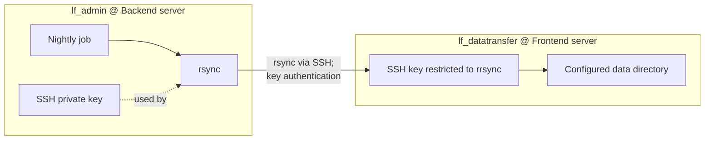

# Rsync via low-privilege user

## Goal

By the end of this guide, you will be able to copy data from one server to another with rsync without entering a password for every run. Data can only be placed in predefined locations. Access is restricted so that the account cannot open an interactive shell or access directories outside the designated storage location.

## Background

We often have a _backend server_ where overnight transformations run. The results are files or directories that need to be transferred to a _frontend server_ running Superset.

The frontend server should not be able to connect to the backend server (pull). Instead, transfers always follow a push pattern and are initiated by the backend server.

## Example setup



- The `lf_admin` user runs the nightly job on the backend server.
- The frontend server has a separate `lf_datatransfer` user with highly restricted permissions. This account exists solely to receive data. (The frontend server can also have an `lf_admin` user, but a dedicated account helps keep data storage separate from other tasks.)

### Prepare the backend server

If it has not already been done, create an SSH key pair for `lf_admin` on the backend server. Use the `-C` option to add a comment that will make it easier to identify the key later.

In this example, the key pair has no passphrase so automated runs do not prompt for one. Alternatively, you can configure an ssh-agent. See, for example, [this guide](https://sshflow.com/blog/ssh-agent/).

```bash
# Create an SSH key pair
ssh-keygen -t ed25519 -f /home/lf_admin/.ssh/id_rsync -C "rsync key for user lf_datatransfer on target host"

# Display the public key
cat /home/lf_admin/.ssh/id_rsync.pub
```

:::warning
SSH key pairs consist of two parts. Copy only the public key, which ends in `.pub`.

**Never share the private key!**
:::

The generated public key will look similar to the following (shortened here for readability). For the configuration, copy the complete contents of the `.pub` file and add it on the frontend server.

```raw
ssh-ed25519 AAAAC3NzabWxCU rsync key for user lf_datatransfer on target host
```

### Prepare the frontend server

Create the restricted `lf_datatransfer` user and add the public key from the backend server.

`rsync` must be installed on both servers. The `rrsync` script is also required on the frontend server (it is included in the standard Ubuntu installation). Check the script's actual location and adjust `/usr/bin/rrsync` in the example below if necessary. See the [official rrsync manual](https://download.samba.org/pub/rsync/rrsync.1).

```bash
# Create a restricted rsync-only user
sudo useradd \
  --system \
  --create-home \
  --home-dir /home/lf_datatransfer \
  --shell /bin/bash \
  lf_datatransfer

# Create the SSH directory and set permissions
sudo mkdir -p /home/lf_datatransfer/.ssh
sudo chown -R lf_datatransfer:lf_datatransfer /home/lf_datatransfer
sudo chmod 700 /home/lf_datatransfer/.ssh

# Add the public key (see the next snippet)
sudo vi /home/lf_datatransfer/.ssh/authorized_keys

# Set permissions on the authorized_keys file
sudo chown lf_datatransfer:lf_datatransfer /home/lf_datatransfer/.ssh/authorized_keys
sudo chmod 600 /home/lf_datatransfer/.ssh/authorized_keys
```

The `authorized_keys` file contains one accepted public key and its settings per line. This entry must be on a single line:

```bash
# On the frontend server: contents of
# /home/lf_datatransfer/.ssh/authorized_keys
command="/usr/bin/rrsync -wo /coasti/products/superset_docker/data/",restrict ssh-ed25519 AAAAC3NzabWxCU rsync key for user lf_datatransfer on target host
```

:::warning
The key shown above is shortened and is only an example; it will not work. Replace the entire key portion with the complete line from the `.pub` file. Never copy the private key.
:::

Explanation:
- `command` restricts logins using this key to the specified command.
- `rrsync` is a wrapper script that checks the server-side commands used by rsync and confines them to the specified directory.
- `-wo` allows this key to transfer data **to** the frontend server only. Files cannot be transferred back to the backend server through this SSH access.
- `restrict` disables several SSH features, including port, agent, and X11 forwarding, as well as allocating a pseudo-terminal. This option is supported by OpenSSH 7.2 and later.
- The rest of the line is the complete public key from the `.pub` file.
- Make sure there are no other entries granting unrestricted access in this account's `authorized_keys` file.

:::note
The path specified with `-wo` is the base directory for the destination path in the rsync command. Paths on the frontend server must always be specified _relative to this directory_.
:::

The destination directory should be owned by `lf_datatransfer` so that this user can write files there. Make sure the user can also traverse all parent directories.

```bash
# Ensure the destination directory exists and is writable by lf_datatransfer
sudo mkdir -p /coasti/products/superset_docker/data/
sudo chown lf_datatransfer /coasti/products/superset_docker/data/
sudo chmod 755 /coasti/products/superset_docker/data/
```

### Use rsync from the backend server

You can now copy files or directories with rsync:

```bash
/usr/bin/rsync \
  -v --perms --chmod=F664,D775 \
  -e "ssh -i /home/lf_admin/.ssh/id_rsync" \
  /path/to/source_file.duckdb \
  lf_datatransfer@frontend_server:target_file.duckdb
```

Explanation of the command:
- `/usr/bin/rsync` starts rsync using its absolute path.
- `-v` (verbose) prints additional information during the transfer, such as which files are being transferred.
- `--perms --chmod=F664,D775` makes rsync set the destination permissions separately for files and directories. Regular files receive `rw-rw-r--` (the owner and group can read and write; others can read only) and are not executable. Directories receive `rwxrwxr-x`. The execute permission on directories is needed to enter them and access the files inside.
- `-e "ssh -i /home/lf_admin/.ssh/id_rsync"` tells rsync to use SSH as its transport and to authenticate with the specified private key.
- `/path/to/source_file.duckdb` is the local source file on the backend server. Replace this example path with the actual path to the file.
- `lf_datatransfer@frontend_server` specifies the user and destination server. Replace `frontend_server` with the frontend server's hostname or IP address.
- The part after the colon, here `target_file.duckdb`, is the destination path **relative to the directory** specified by `rrsync -wo` in `authorized_keys`.
    - With the setting shown above, the file is therefore written to `/coasti/products/superset_docker/data/target_file.duckdb`.
    - You can also specify a relative subdirectory, such as `archive/target_file.duckdb`; that subdirectory must already exist.
    - The destination path does **not** refer to an arbitrary path on the destination server: `rrsync` confines access to the configured directory.

:::note
`-wo` limits this SSH access to uploads; the `F664` file permissions still allow the owner and group to read and write the received files. These filesystem permissions do not grant download access through this SSH key. The first SSH connection may also prompt you to confirm the server's host key. Verify its fingerprint before accepting it.
:::
