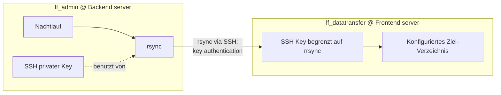

# Rsync mit abgesichertem User

## Ziel

Am Ende des Artikels ist es möglich, Daten per rsync von einem Server auf einen anderen zu kopieren, ohne bei jedem Lauf ein Passwort einzugeben.
Die Daten können nur an vordefinierten Stellen abgelegt werden. Der Zugang ist so eingeschränkt, dass weder eine interaktive Shell noch Zugriffe auf Ordner außerhalb der Dateiablage möglich sind.

## Hintergrund

Oft haben wir einen _Backend-Server_, auf dem nächtliche Transformationen stattfinden. Die Ergebnisse liegen dann als Dateien oder Ordner vor und sollen an einen _Frontend-Server_ übertragen werden, auf dem Superset läuft.
Dabei soll der Frontend-Server keine Möglichkeit haben, sich mit dem Backend-Server zu verbinden (Pull). Die Übertragung folgt immer einem Push-Muster und wird vom Backend-Server aus initiiert.

## Umsetzung an einem Beispiel



- Auf dem Backend-Server führt der Benutzer `lf_admin` den Nachtlauf aus.
- Auf dem Frontend-Server gibt es den Benutzer `lf_datatransfer` mit stark eingeschränkten Berechtigungen. Er dient ausschließlich dazu, Daten entgegenzunehmen.
  (Auf dem Frontend-Server kann es zusätzlich einen Benutzer `lf_admin` geben. Der dedizierter Benutzer hilft jedoch, die Datenablage von anderen Aufgaben zu trennen.)

### Vorbereitung auf dem Backend Server

Falls noch nicht geschehen erstellen wir ein SSH-Key-Pair für `lf_admin` auf dem Backend Server. Mit der Option `-C` hinterlegen wir einen Kommentar, um später die Zuordnung zu vereinfachen.

In diesem Beispiel wird das Schlüsselpaar ohne Passphrase angelegt, damit bei automatisierten Läufen keine Passphrase abgefragt wird. Alternativ kann der ssh-agent konfiguriert werden. Siehe [z.B. hier](https://sshflow.com/blog/ssh-agent/).

```bash
# create ssh key pair
ssh-keygen -t ed25519 -f /home/lf_admin/.ssh/id_rsync -C "rsync key for user lf_datatransfer on target host"

# have a look at the created public key
cat /home/lf_admin/.ssh/id_rsync.pub
```

:::warning
SSH-Key-Pairs bestehen immer aus zwei Teilen. Bitte ausschließlich den öffentlichen Key kopieren, der in `.pub` endet.

**Der private Key sollte niemals geteilt werden!**
:::

Der erzeugte öffentliche Key sieht dann wie folgt aus (hier zur Lesbarkeit gekürzt). Für die Konfiguration muss der vollständige Inhalt der `.pub`-Datei kopiert und auf dem Frontend-Server hinterlegt werden.

```raw
ssh-ed25519 AAAAC3NzabWxCU rsync key for user lf_datatransfer on target host
```

### Vorbereitung auf dem Frontend Server

Zunächst erzeugen wir den gewünschten Benutzer mit eingeschränkten Rechten `lf_datatransfer` und fügen den öffentlichen Key vom Backend-Server hinzu.

Voraussetzung ist, dass `rsync` auf beiden Servern installiert ist.
Auf dem Frontend-Server wird zusätzlich `rrsync` benötigt (ist aber Teil der Ubuntu Standard-Installation).
Siehe offizielle Doku: [rrsync manpage](https://download.samba.org/pub/rsync/rrsync.1)

```bash
# bash
# Create a restricted rsync-only user
sudo useradd \
  --system \
  --create-home \
  --home-dir /home/lf_datatransfer \
  --shell /bin/bash \
  lf_datatransfer

# Create SSH directory and set permissions
sudo mkdir -p /home/lf_datatransfer/.ssh
sudo chown -R lf_datatransfer:lf_datatransfer /home/lf_datatransfer
sudo chmod 700 /home/lf_datatransfer/.ssh

# Add public key, see next code snippet
sudo vi /home/lf_datatransfer/.ssh/authorized_keys

# Set permissions of the authorized_keys file
sudo chown lf_datatransfer:lf_datatransfer /home/lf_datatransfer/.ssh/authorized_keys
sudo chmod 600 /home/lf_datatransfer/.ssh/authorized_keys
```


Der Inhalt der `authorized_keys` sieht wie folgt aus. Jede Zeile enthält jeweils einen akzeptierten Public Key und seine Einstellungen. Unser Eintrag muss also in eine einzelne Zeile:

```bash
# Auf dem Frontend-Server: Inhalt von
# /home/lf_datatransfer/.ssh/authorized_keys
command="/usr/bin/rrsync -wo /coasti/products/superset_docker/data/",restrict ssh-ed25519 AAAAC3NzabWxCU rsync key for user lf_datatransfer on target host
```

Erklärung:
- `command` beschränkt die Anmeldung mit diesem Schlüssel auf den angegebenen Befehl.
- `rrsync` ist ein Wrapper-Skript, das die von rsync verwendeten Server-Aufrufe prüft und auf das angegebene Verzeichnis beschränkt.
- `-wo` erlaubt mit diesem Schlüssel nur Übertragungen **zum** Frontend-Server. Dateien können über diesen SSH-Zugang nicht zurück auf den Backend-Server übertragen werden.
- `restrict` deaktiviert mehrere SSH-Funktionen, darunter Port-, Agent- und X11-Weiterleitung sowie die Vergabe eines Pseudo-Terminals. Die Option wird von OpenSSH ab Version 7.2 unterstützt.
- Der Rest der Zeile ist der vollständige öffentliche Schlüssel aus der `.pub`-Datei.
- Es sollten keine weiteren Zeilen (mit uneingeschränkten Schlüsseln) in dieser `authorized_keys` eingetragen sein.

:::note
Der mit `-wo` angegebene Zielpfad bildet das Basisverzeichnis für den Zielpfad im rsync-Befehl. Dateipfade auf dem Frontend-Server müssen immer _relativ zu diesem Verzeichnis_ angegeben werden.
:::

Das Ziel-Verzeichnis sollte `lf_datatransfer` gehören, sodass dieser Benutzer dort Dateien ablegen kann.

```bash
# Sicherstellen, dass der Ziel-Ordner existiert und lf_datatransfer Schreibrechte hat
sudo mkdir -p /coasti/products/superset_docker/data/
sudo chown lf_datatransfer /coasti/products/superset_docker/data/
sudo chmod 755 /coasti/products/superset_docker/data/
```

### Nutzung auf dem Backend Server

Nun können Dateien oder Verzeichnisse mit rsync kopiert werden:

```bash
/usr/bin/rsync \
  -v --perms --chmod=F664,D775 \
  -e "ssh -i /home/lf_admin/.ssh/id_rsync" \
  /path/to/source_file.duckdb \
  lf_datatransfer@frontend_server:target_file.duckdb
```

Erklärung des Befehls:
- `/usr/bin/rsync` startet das Programm `rsync` über seinen absoluten Pfad.
- `-v` (verbose) gibt während der Übertragung zusätzliche Informationen aus, zum Beispiel welche Dateien übertragen werden.
- `--perms --chmod=F664,D775` sorgt dafür, dass rsync die Berechtigungen auf dem Ziel setzt und sie dabei getrennt für Dateien und Verzeichnisse anwendet: Reguläre Dateien erhalten `rw-rw-r--` (Eigentümer und Gruppe dürfen lesen und schreiben, andere nur lesen); sie sind nicht ausführbar. Verzeichnisse erhalten `rwxrwxr-x`. Das Ausführungsrecht bei Verzeichnissen ist nötig, damit Benutzer diese betreten und auf die darin enthaltenen Dateien zugreifen können.
- `-e "ssh -i /home/lf_admin/.ssh/id_rsync"` weist `rsync` an, SSH als Transport zu verwenden und den dort angegebenen privaten Key zur Anmeldung zu nutzen.
- `/path/to/source_file.duckdb` ist die lokale Quelldatei auf dem Quell-Server.
- `lf_datatransfer@frontend_server` bezeichnet den Benutzer und den Ziel-Server.
- Der Teil nach dem Doppelpunkt, hier `target_file.duckdb`, bezeichnet den Zielpfad **relativ zu dem Verzeichnis**, das in `authorized_keys` bei `rrsync -wo` festgelegt wurde.
    - Mit der oben gezeigten Einstellung `/coasti/products/superset_docker/data/` wird die Datei daher unter `/coasti/products/superset_docker/data/target_file.duckdb` abgelegt.
    - Es kann ebenfalls ein Unterverzeichnis angegeben werden, zum Beispiel `archiv/target_file.duckdb`; dieses Unterverzeichnis muss bereits existieren.
    - Der Zielpfad bezeichnet also **nicht** (wie sonst für rsync üblich) einen beliebigen Pfad auf dem Ziel-Server: `rrsync` begrenzt den Zugriff auf das konfigurierte Verzeichnis.


